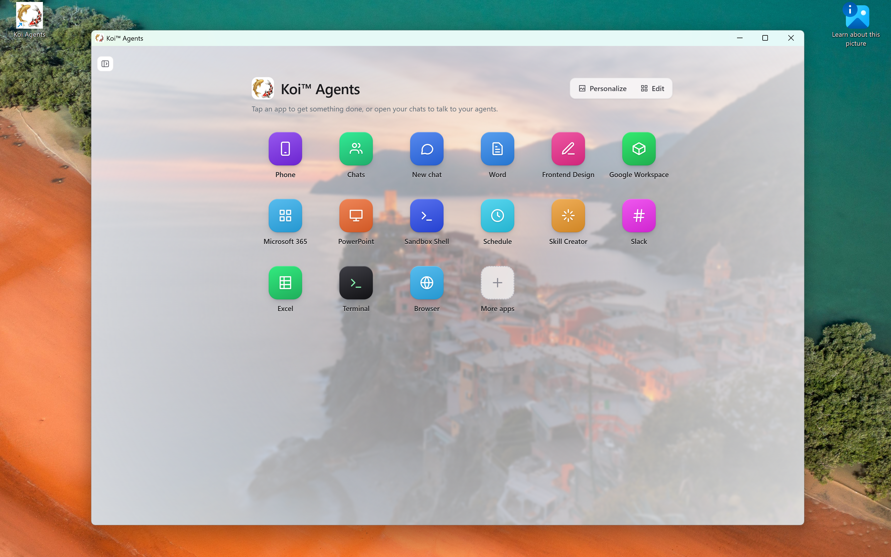
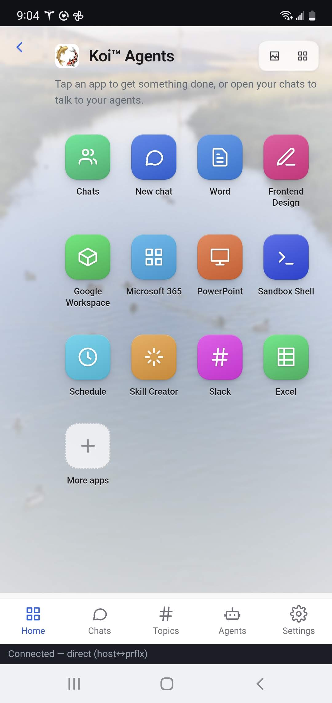
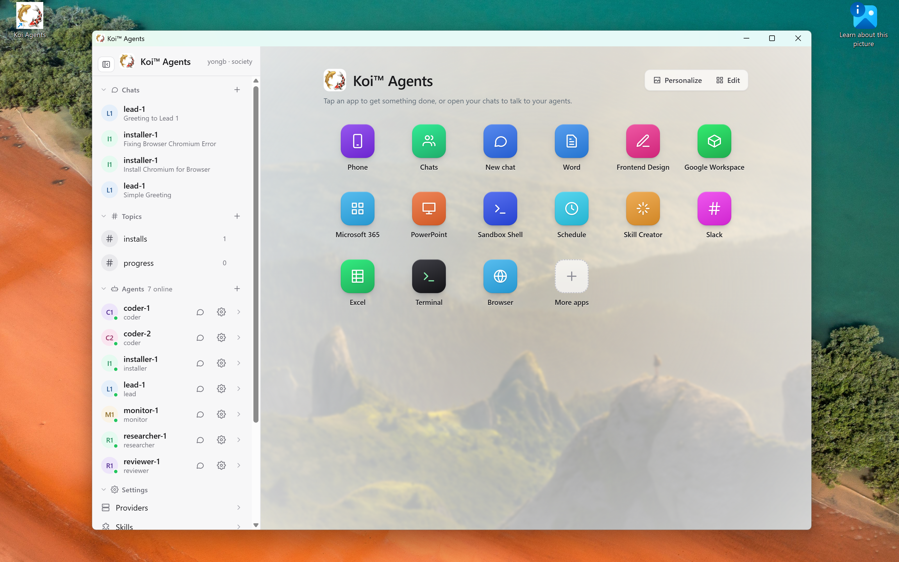

# Koi™ Agents 0.1.0 for Windows

**No cloud agents, yet you get AI agents working for you 24/7, on the PC you already own.**
Your agents, chats and files stay on your PC. Talk to your agents from the desktop app or from
your phone, one at a time or as a group.

**Download:** [KoiAgents-Setup-0.1.0.exe]($DOWNLOAD_LINK) (about 450 MB)

**You need:** Windows 10 (2004 or newer) or 11, 64-bit, with virtualization turned on in the
BIOS (it is on by default on most PCs). You also need an AI subscription (Claude, ChatGPT,
Gemini, Grok, Kimi…) or an API key.

---

## 1. Install

1. Run **KoiAgents-Setup-0.1.0.exe**. If Windows says **"Windows protected your PC"**, click
   **More info → Run anyway**.
2. Accept the **License Agreement**.
3. **Create the agents' account.** Pick a username (lowercase letters and numbers) and a
   password. The agents run under this account in their own private Linux machine.
   **Write the password down.** You type it only when an agent asks you to approve an
   administrator command.
4. Wait a few minutes, then click **Open Koi Agents**.

> If WSL is not on yet, setup asks for administrator permission and a restart. After the
> restart, setup continues by itself.

## 2. Set up

1. **Start your free trial.** Click **Start free trial on Polar** and finish checkout.
   **The first 3 months are free.** Then paste your license key and click **Activate**.
   A Koi Assistant (browser extension) subscription works here too.
2. **Connect your AI.** Click **Connect to a provider**, then either:
   - **Sign in** with your subscription, choose a model, and click **Test and use**, or
   - add your **API key**.

   Tick **Make every agent use it**.

3. **Connect your accounts (optional).** If you want your agents to read and work with your
   email, calendar, files or messages, open **Settings → Accounts** and connect
   **Google Workspace**, **Microsoft 365** or **Slack** (Slack asks you to paste a token from
   your Slack app). Then choose which agents may use each account. You can also skip this: when an agent first needs an account, it asks you to
   connect it.
4. **Pair your phone (optional).** On the home page, open **Phone**, turn on **Remote access**, and scan
   the QR code with your phone's camera. Once the page shows **Connected**, install it as an app:
   - **iPhone (Safari):** Share → **Add to Home Screen**
   - **Android (Chrome):** **Install**

   

   > Treat the QR code like a key. If someone else gets it, click **Reset pairing**.

## 3. Chat with your agents

Your team: **lead-1** (your main helper), **researcher-1** (looks things up), **coder-1**
(files and code), and **installer-1** (sets up skills).

- **One-on-one:** click an agent, or click **New chat** and type `@lead-1 …`.
- **Group:** `@mention` several agents, for example
  `@researcher-1 @lead-1 compare 3 laptops under $1000 in a spreadsheet`.
  Name the chat to turn it into a **topic**, where every member reads every message.
- **Approvals:** before doing anything sensitive, an agent asks you with an
  **Approve / Deny** card.
- **Phone:** everything works the same way on your phone.

**Best-of-N:** when an agent is stuck on a hard problem, it can try N different approaches
at once and finish each one separately. You get a better chance of a good result, but it
uses more of your AI quota. It is off by default and needs a provider that supports it.

### 3.1 Access the agents's machine

Use terminal to get direct console access to the machine.
Use Windows Explorer's `\\wsl.localhost\KoiSociety` to see all files of the machine

## 4. Add skills

Built-in skills cover Word, Excel, PowerPoint, PDF, Google Workspace, Microsoft 365, Slack,
the web, and scheduling. **Any skill made for Claude** (a folder with a `SKILL.md` file) also
works:

1. Open **More apps → Skills → Install** and pick the skill's folder.
2. Open an agent's settings and tick the skill.

## 5. Schedules and watches

Ask **lead-1** in plain words:

- **Later, or repeating:** "In 2 hours, remind me to call Bob." · "Every weekday at 9 AM,
  summarize my unread email."
- **Watch for something:** "Check this page every hour and tell me if the price drops
  below $500."

To see your jobs, say **"list my schedules"**. To stop one, say **"cancel schedule \<name\>"**.

> Jobs run only while the agents are running. Leave the app open, or tick **Keep agents
> running when the window is closed** in the installer. Each run uses your AI quota.

---

**Update:** run the newer installer. Your data is kept.
**Uninstall:** Windows Settings → Apps → Koi Agents. It asks whether to also delete your
agents' data.
**Problems?** Check `%LOCALAPPDATA%\KoiSociety\setup.log`. If an agent reports a sign-in
error, sign in again under **Settings → Providers**.

Koi™ Agents © Rollingdell Software Service, LLC. Use is subject to the [EULA](EULA.txt).
AI can make mistakes, so review what your agents do before you approve it.
